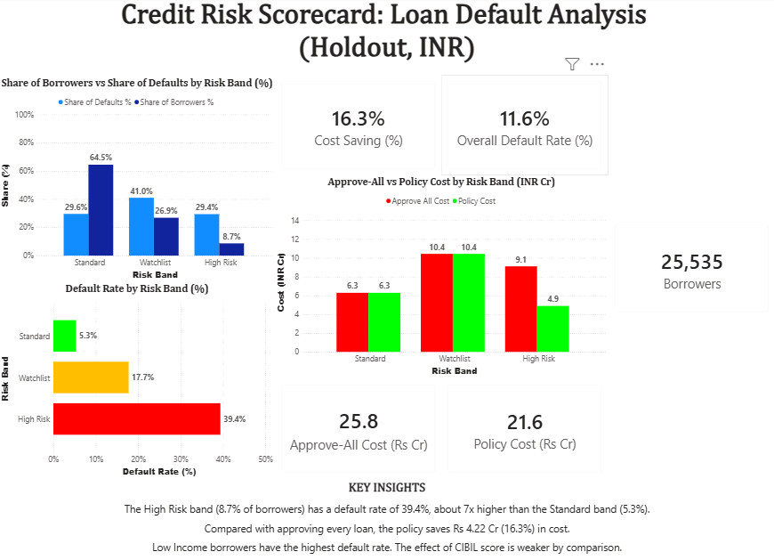
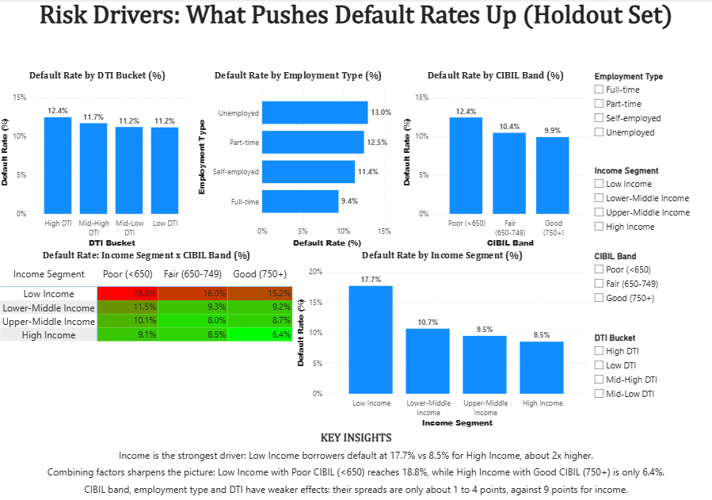

# Credit Risk Scorecard for Indian Retail Lending

**Approve / Manual Review / Reject: a simple, interpretable loan default risk scorecard built with Python, MySQL and Power BI.**

---

## Problem Statement

A lender receives thousands of loan applications and cannot manually review every one. This project answers two questions:

1. **Which applicants are likely to default?**
2. **What action should the lender take for each applicant?**

Borrowers are scored with a Logistic Regression model (AUC 0.76, chosen for interpretability) and placed into three RBI-inspired risk bands, each mapped to a clear action: **Approve**, **Manual Review** or **Reject**. The Reject cut-off is not the default 0.5 but a **cost-based threshold (0.74)** picked on a validation half using explicit costs (LGD 60%; a missed defaulter costs ~3.7x a wrongly rejected good borrower). All results below are on a separate **holdout half (25,535 loans)**.

---

## Dashboard Preview

**Executive Summary**



**Risk Drivers**



*Dashboard built in Power BI on the holdout set (25,535 borrowers). File: `dashboard/Credit_Risk_Analyzer.pbix`*

---

## Dataset

- **Source:** Kaggle, [Loan Default Prediction Dataset](https://www.kaggle.com/datasets/nikhil1e9/loan-default) (by nikhil1e9)
- **Size:** ~255k rows, 18 columns
- **Target:** `Default` (1 = defaulted, 0 = repaid), with class imbalance (defaults are the minority class)
- **Key columns:** Age, Income, LoanAmount, CreditScore, MonthsEmployed, NumCreditLines, InterestRate, LoanTerm, DTIRatio, EmploymentType, and others
- **Currency:** Amounts are treated directly as **illustrative INR** (no currency conversion) to keep the story in an Indian lending context.

> The raw Kaggle file is not included in this repo. The scored output used for SQL and Power BI is in `data/loan_scored_final.csv`.

---

## Approach

```
EDA → Feature Engineering → Risk Factors → Segmentation → Models → Threshold Tuning → Scorecard → SQL + Power BI
```

| Step | What was done |
|---|---|
| **EDA** | Missing values, class imbalance, distributions and boxplots for income and loan amount |
| **Feature engineering** | Encoded categoricals; derived `LoanToIncomeRatio`, `EMItoIncomeRatio`, `MonthlyEMI_est`; built a composite. **RiskIndex** (v1 with manual weights, v2 with correlation-derived weights) |
| **Risk factors** | Default rate by Income Segment, CIBIL-style Band (Poor / Fair / Good), Employment Type, DTI bucket and RiskIndex band |
| **Segmentation** | Rule-based bands on RiskIndex_v2 (40/40/20 percentile cut-offs) with RBI-inspired naming: Standard / Sub-standard (Watchlist) / Doubtful |
| **Models** | Logistic Regression (scaled, `class_weight='balanced'`) and a shallow Decision Tree (`max_depth=4`) |
| **Evaluation** | Precision, Recall, F1, AUC-ROC and confusion matrix (accuracy was avoided due to class imbalance) |
| **Threshold tuning** | Cost-based threshold using false-negative vs false-positive cost, tuned on a validation half and tested on a holdout half |
| **Scorecard** | Final risk bands mapped to actions, with INR business impact |
| **SQL + Power BI** | 6 MySQL queries and a 2-page Power BI dashboard |

**Leakage control:** `RiskIndex`, `*_norm` columns, segment and bucket columns were excluded from model inputs. Final model matrix: 255,347 rows × 25 features.

---

## Key Findings

### Top 3 risk factors (odds ratio per 1 SD, Logistic Regression)

1. **Loan-to-Income ratio (1.61x):** a larger loan relative to income raises default odds the most among actionable factors.
2. **Interest rate (1.59x):** higher-rate loans default more (the rate itself may partly reflect risk-based pricing).
3. **Months employed (0.71x):** a longer employment history lowers default odds.

> **Age (0.55x)** is the strongest signal in the model, but it is treated as an **analytical insight only, not a decision rule**, because of fair-lending concerns.

### Default rate by factor (EDA stage)

| Factor | Highest-risk group | Lowest-risk group | Spread |
|---|---|---|---|
| Income Segment | Low income: 17.38% | High income: 9.02% | 8.36 pts |
| Employment Type | Unemployed: 13.55% | Full-time: 9.46% | 4.09 pts |
| CIBIL-style Band | Poor (<650): 12.28% | Good (750+): 10.08% | 2.20 pts |
| DTI Bucket | High: 12.31% | Low: 10.66% | 1.65 pts |
| RiskIndex_v2 Band | High Risk: 18.83% | Low Risk: 7.37% | 11.46 pts |

The composite RiskIndex_v2 gave the widest spread of all factors tested, so it works as a strong single risk signal.

---

## Risk Scorecard

Final bands from Logistic Regression risk score (holdout set, 25,535 borrowers). Naming is **inspired by** RBI asset-classification terminology and is not an official NPA classification.

| Risk Band | Risk Score | Action | Default Rate | % of Applicants | % of All Defaults |
|---|---|---|---|---|---|
| **Standard** | < 0.50 | Approve | 5.3% | 64.5% | 29.6% |
| **Watchlist** (SMA-style) | 0.50 to 0.74 | Manual Review | 17.7% | 26.9% | 41.0% |
| **High Risk** (Sub-standard+ style) | ≥ 0.74 | Reject | 39.4% | 8.7% | 29.4% |

The High Risk band defaults at about **3.4x the portfolio average**, while the Standard band defaults at about **0.5x**. The **0.74** Reject line is the cost-optimal threshold, not the default 0.5.

### Recommendation

- **Standard (64.5%):** auto-approve.
- **Watchlist (26.9%):** manual review (income and document verification, co-signer, lower limit or shorter tenure).
- **High Risk (8.7%):** reject.

---

## Model Results

**At default threshold 0.5:**

| Model | Precision | Recall | F1 | AUC-ROC |
|---|---|---|---|---|
| **Logistic Regression** | 0.228 | 0.697 | 0.344 | **0.7616** |
| Decision Tree (depth 4) | 0.218 | 0.599 | 0.319 | 0.7154 |
| RiskIndex_v2 (rule-based benchmark) | n/a | n/a | n/a | 0.6236 |

Logistic Regression performs best and is also the easier one to explain to business teams. The model captures **51.5% of all defaults in its riskiest 20%** of borrowers, compared with 35.5% for the rule-based RiskIndex_v2.

**After cost-based threshold tuning:**

| Model | Optimal Threshold | Cost Saving vs 0.5 (test half) |
|---|---|---|
| Logistic Regression | **0.74** | 17.0% |
| Decision Tree | 0.68 | 14.9% |

At 0.74, Logistic Regression gives Precision 39.4% and Recall 29.4%. Recall drops because only the riskiest borrowers are rejected, while borderline cases go to Manual Review instead of automatic rejection.

---

## Business Impact (INR, holdout set, illustrative)

**Cost assumptions:** LGD (loss given default) = 60%, net margin = 40%. A missed defaulter costs about 3.7x a wrongly rejected good borrower.

| Policy | Expected Cost |
|---|---|
| Reject everyone | ₹45.01 Cr |
| Approve everyone | ₹25.85 Cr |
| **Scorecard policy (Approve / Review / Reject)** | **₹21.63 Cr** |

- The scorecard policy saves **16.3% (₹4.22 Cr)** vs approve-all.
- The Reject band avoids **₹9.11 Cr** of defaulter losses while forgoing **₹4.89 Cr** of margin on good borrowers.
- The model captures 51.5% of defaults in its riskiest 20%, vs 35.5% for the rule-based RiskIndex.

**Robustness to the loss assumption (LGD sensitivity):**

| LGD | 40% | 60% | 80% |
|---|---|---|---|
| Cost saving | 9.5% | 16.3% | 23.9% |
| Best LogReg threshold | 0.80 | 0.74 | 0.67 |

The higher the loss on each default, the more aggressive the optimal Reject line becomes.

---

## SQL Queries

MySQL database `credit_risk`, table `loan_scored_final` (51,070 rows; the `Default` column is renamed `DefaultFlag` for MySQL). All 6 queries are in [`sql/credit_risk_queries.sql`](sql/credit_risk_queries.sql) and were validated against the notebook numbers. For table creation use this sql query : [`sql/table_creation.sql`](sql/table_creation.sql)

| Query | Purpose |
|---|---|
| Q1 | Segment-wise default rate |
| Q2 | To check share of borrowers vs share of defaults |
| Q3 | To know borrowers count and default rate according to Employment type and Risk band |
| Q4 | Default rate and borrower count by Income segment and CIBIL Band |
| Q5a | Business impact by band (INR Cr, holdout) |
| Q5b | To check Approve-all cost vs policy cost (holdout) |
| Q6 | Top 10 riskiest borrower groups |

---

## Limitations & Next Steps

- **Manual review cost not modelled:** The headline cost treats Watchlist loans as approved. Review effort and its cost are not included, and having 27% of applicants in review is operationally heavy.
- **Moderate discrimination:** AUC 0.76, with recall 29% and precision 39% at the reject line. This is a **screening aid, not an autonomous decision-maker**.
- **Ranking scores, not probabilities:** The model is class-weighted, so scores are not calibrated probabilities.
- **Simple, interpretable model:** Built to show analytical thinking and explainability, not production-grade accuracy.
- **Illustrative INR amounts:** Dataset amounts are treated as INR for storytelling and are not real Indian loan values.
- **Public dataset:** This is a Kaggle dataset, not real bank data, so results are not directly transferable to an actual lender's portfolio.
- **Assumed cost parameters:** LGD (60%) and net margin (40%) are assumptions; see the LGD sensitivity table above.
- **RBI-style naming is inspirational:** Band names follow RBI asset-classification terminology but are not official NPA categories (real NPA classification depends on days past due). The CIBIL-style credit score bands are also for framing only.
- **No external validation:** Results come from a holdout split of the same dataset.
- **Next:** add real CIBIL bureau data, calibrate scores, and cost the manual review process.

---
